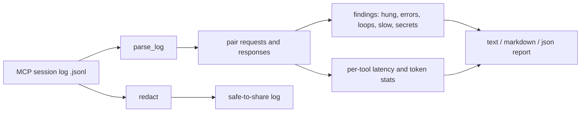

# MCP Log Analyzer: find hung, failing and looping MCP tool calls in your Claude Code / agent session logs

   

**MCP Log Analyzer is a free, open-source, zero-dependency Python CLI that reads an MCP (Model Context Protocol) JSON-RPC session log and tells you which tool calls hung, failed, looped, ran slow, bloated your context or leaked a secret. It is for developers building or debugging MCP servers and Claude Code / AI agent setups.**

## Why / problem it solves

MCP debugging is hard because failures hide in live traffic: a tool call that never returns, a call that "succeeds" but has `isError: true`, an agent calling the same tool five times in a loop, or a 30k-token result silently eating your context window. Log files are scattered and unreadable. This tool turns one JSONL capture into a clear report you can paste into an issue, and a sanitized copy that is safe to share with teammates or an LLM.

## 2-minute Quickstart

```bash
git clone https://github.com/Waqas-Ai-Engineer/mcp-log-analyzer
cd mcp-log-analyzer
python mla.py demo                                   # offline demo on synthetic SAMPLE DATA
python mla.py analyze example_mcp_session.jsonl      # analyze a log file
python mla.py analyze example_mcp_session.jsonl --format markdown --fail-on high   # CI-friendly
python mla.py redact example_mcp_session.jsonl -o safe.jsonl   # share-safe copy
python -m unittest                                   # run the tests
```

Needs only Python 3.9+. No pip install.

## Demo output

Produced by running `python mla.py demo` (SAMPLE DATA, synthetic session):

```text
SAMPLE DATA - synthetic session, nothing here is real.

MCP LOG ANALYZER REPORT
=======================
messages=24 requests=12 responses=11 notifications=1 parse_errors=1
tool_calls=10 failure_rate=30% duration_s=15.9 est_response_tokens=7679
findings: high=2 medium=4 low=3

PER-TOOL STATS
tool               calls  err hung   avg_s   p95_s  ~tokens
delete_records         1    1    0    0.05    0.05       14
read_file              4    0    0   0.125     0.2       72
run_query              2    1    0     3.8     6.5       32
search_docs            3    0    1    0.65     0.9     7523

FINDINGS
  [HIGH  ] SECRET_IN_TRAFFIC  line 9    Possible secret (aws_access_key_id) in message payload. Redact before sharing.
  [HIGH  ] UNANSWERED_REQUEST line 22   search_docs (id=11) never got a response (hung or dropped).
  [MEDIUM] TOOL_ERROR         line 10   run_query: call returned normally but result.isError=true: syntax error near SELEC
  [MEDIUM] REPEATED_CALL      line 12   read_file was called 3x with identical arguments (possible agent loop).
  [MEDIUM] RPC_ERROR          line 20   delete_records: JSON-RPC error: Unknown tool: delete_records
  [MEDIUM] UNKNOWN_TOOL       line 20   Tool 'delete_records' was called but is not in tools/list.
  [LOW   ] SLOW_CALL          line 18   run_query took 6.50s (threshold 2s).
  [LOW   ] LARGE_PAYLOAD      line 23   search_docs returned ~7510 tokens of context; consider paging or trimming.
  [LOW   ] PARSE_ERROR        line 25   Skipped line: invalid JSON (Expecting value)
```

## Features

- Pairs JSON-RPC requests with responses and measures per-tool latency (avg and p95).
- Flags unanswered (hung) requests, JSON-RPC errors, and tool results with `isError: true`.
- Detects calls to tools that are not in `tools/list`, and repeated identical calls (agent loops).
- Estimates response tokens per tool and flags oversized payloads that bloat context.
- Detects secret-looking strings (cloud keys, tokens, private keys) and never prints them.
- `redact` writes a sanitized log you can share. Output as text, Markdown or JSON; `--fail-on` sets the exit code for CI.
- Reads raw JSON-RPC lines or wrapped lines like `{"ts":..., "dir":"c2s", "msg":{...}}`.

## How it works



Files: `mla.py` (entry), `mla_cli.py` (CLI), `mla_core.py` (engine), `mla_report.py` (renderers), `mla_sample.py` (synthetic demo data).

## Use cases

- Debug an MCP server that "sometimes does nothing" in Claude Code or another agent client.
- Gate CI on session quality: fail a build if an agent run has hung calls or leaked secrets.
- Spot context bloat: which tool returns the most tokens?
- Share a bug report with a sanitized log instead of raw traffic.

## Capturing a log

Any proxy or wrapper that writes one JSON-RPC message per line works (stdio wrapper, HTTP proxy, or your client's debug log). Add a `ts` (epoch seconds or ISO-8601) per line to get latency numbers. Without timestamps you still get errors, loops, secrets and unknown tools.

## FAQ

**What is an MCP log analyzer?** A tool that reads recorded Model Context Protocol traffic and reports problems such as hung requests, errors and slow tools.

**How do I debug an MCP server that hangs?** Capture the session as JSONL and run `python mla.py analyze log.jsonl`; unanswered requests appear as `UNANSWERED_REQUEST` with the line number.

**How do I find agent loops in Claude Code?** The `REPEATED_CALL` finding flags a tool called repeatedly with identical arguments; tune it with `--repeat`.

**Is this an alternative to MCP Inspector?** No, it is complementary. Inspector tests a server interactively; this analyzes recorded sessions after the fact.

**Does it send my logs anywhere?** No. It is offline, uses only the Python standard library and makes no network calls.

**Can I safely paste my log into an LLM?** Run `redact` first and review the output yourself; redaction is pattern-based and not a guarantee.

**Does it work without timestamps?** Yes, but latency and slow-call checks need a `ts` field.

**Which Python versions?** 3.9 and newer.

## Authorized use only

Analyze only logs you own or are explicitly authorized to inspect. See COMPLIANCE.md. Sample data is synthetic; the AWS key in the sample is the public documentation example, not a credential.

## Roadmap

- Stdio and HTTP capture wrapper that writes this log format.
- HTML report and trend comparison between two sessions.
- Optional JSON-RPC batch message support.

## Contributing

Issues and PRs welcome, see CONTRIBUTING.md. Please add a test with every change.

## Hire me / Need this built?

Muhammad Waqas, AI Agents & Business Automation. Custom MCP servers, AI agents and workflow automation: https://github.com/Waqas-Ai-Engineer

## License

MIT, see LICENSE.

---
Star this repo if it helped.
Follow @Waqas-Ai-Engineer for daily open-source automation tools.
